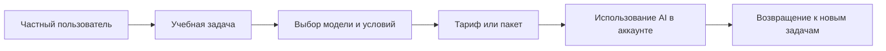

# B2C и монетизация Velocity

[← Обзор проекта](https://github.com/SayGGGo/Velocity/blob/main/)

<a href="https://isvelocity.ru/"><picture><source media="(prefers-color-scheme: dark)" srcset="https://raw.githubusercontent.com/SayGGGo/VelocityReadmeAssets/main/business-dark-77c4e3f750cd.png"><source media="(prefers-color-scheme: light)" srcset="https://raw.githubusercontent.com/SayGGGo/VelocityReadmeAssets/main/business-light-fa8bde4e4e6d.png"></picture></a>

## Для кого и какую ценность даём

Частный пользователь: школьник, студент или человек, осваивающий новую тему.
Задача → личный аккаунт → выбор AI-инструмента → практика и результат.
Пики потребности: подготовка к ЕГЭ/ОГЭ, сессия, начало учебного года,
сдача учебных проектов. Это сценарии продукта, не опубликованная аналитика продаж.

## Направления дохода

| Направление | Механизм | Статус |
| :--- | :--- | :--- |
| AI-инструменты | Тарифы моделей, пакеты токенов, баланс | Механизмы реализованы; предложения и доступность определяются интерфейсом и офертой |
| VLTY SHOP | Продажа фирменного мерча | Подготовка к запуску; заказы пока недоступны |

Платёжная интеграция в коде не означает доступность всех способов оплаты.
Цена и состав услуги подтверждаются перед покупкой. Доходность не гарантируется.

## Что измерять дальше

Конверсию регистрации в первое полезное действие, покупку и повторную покупку;
удержание пользователей; себестоимость AI-запросов, инфраструктуры и поддержки;
возвраты и обращения. Выручка и маржинальность без подтверждённых данных не заявляются.

[Проблема и решение](docs/PROBLEM.md) · [План](TODO.md) · [Безопасность](SECURITY.md)

Коврик для мыши VELOCITY: планируемая цена **1 290 ₽**. Компактное превью
использует исходный принт; заказы пока не открыты.

<a href="https://isvelocity.ru/"><picture><source media="(prefers-color-scheme: dark)" srcset="https://raw.githubusercontent.com/SayGGGo/VelocityReadmeAssets/main/businessflow-dark-9c8366c3afcc.png"><source media="(prefers-color-scheme: light)" srcset="https://raw.githubusercontent.com/SayGGGo/VelocityReadmeAssets/main/businessflow-light-c5fe6c84bda3.png"></picture></a>

