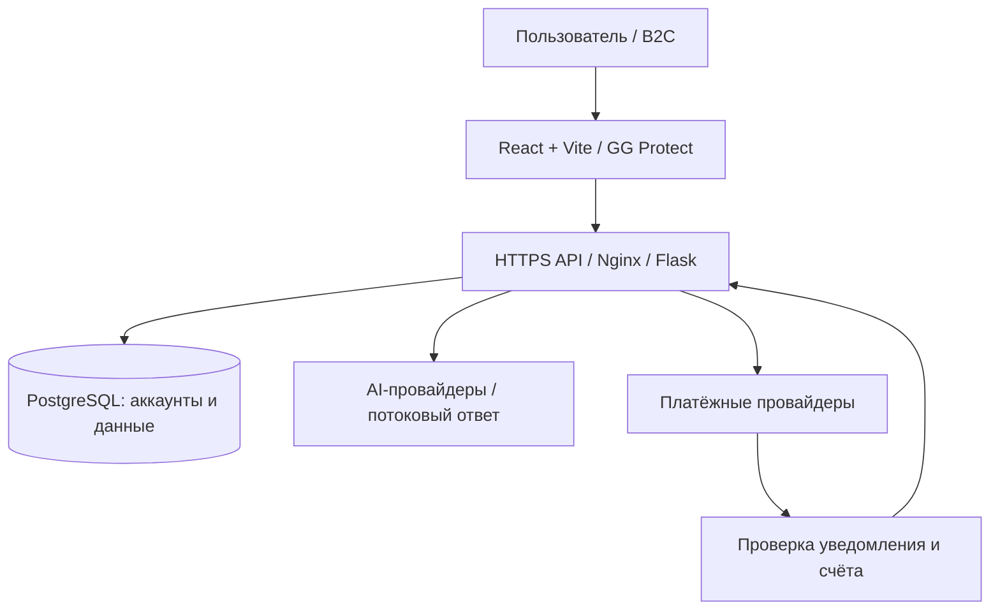

# Архитектура Velocity

[← Обзор проекта](https://github.com/SayGGGo/Velocity/blob/main/)

<a href="https://isvelocity.ru/"><picture><source media="(prefers-color-scheme: dark)" srcset="https://raw.githubusercontent.com/SayGGGo/VelocityReadmeAssets/main/architecture-dark-1f0a3eb3ea71.png"><source media="(prefers-color-scheme: light)" srcset="https://raw.githubusercontent.com/SayGGGo/VelocityReadmeAssets/main/architecture-light-bde5c8d387c1.png"></picture></a>

## Архитектура

Интерфейс на React обеспечивает работу личного кабинета, обучения и AI-чата.
Серверная часть на Flask обрабатывает запросы, управляет аккаунтами и связывает
приложение с AI- и платёжными сервисами. Данные хранятся в PostgreSQL.

Обмен между интерфейсом и сервером проходит через HTTPS API.

Подробнее: [безопасность](../SECURITY.md),
[материалы](../MATERIALS_POLICY.md), [участие](../CONTRIBUTING.md).
