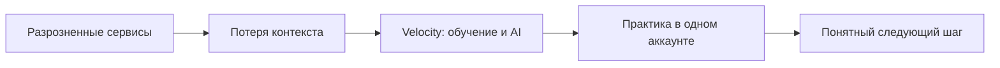

# Проблема → решение

[← Обзор проекта](https://github.com/SayGGGo/Velocity/blob/main/)

<a href="https://isvelocity.ru/"><picture><source media="(prefers-color-scheme: dark)" srcset="https://raw.githubusercontent.com/SayGGGo/VelocityReadmeAssets/main/problem-dark-bc84d729554a.png"><source media="(prefers-color-scheme: light)" srcset="https://raw.githubusercontent.com/SayGGGo/VelocityReadmeAssets/main/problem-light-3bf8375125c1.png"></picture></a>

## Проблема

Материалы, инструменты AI и учёт прогресса находятся в разных сервисах.
Переключения между ними усложняют сохранение контекста и выбор следующего шага.
Это продуктовая гипотеза, которую ещё нужно подтвердить пользовательским исследованием.

## Решение Velocity

Личный дашборд, практика, история работы и AI-чат в одном пространстве.
Пользователь может вернуться к задаче, выбрать инструмент и увидеть прогресс.

## Схема решения

## Как проверять гипотезу

Провести интервью с учениками и студентами; дать короткие сценарии на прототипе;
измерить долю завершённых задач и время до первого полезного результата;
сравнить с текущим способом работы участников. Не подменять результаты исследования
количеством звёзд GitHub. Ответы AI проверяются; оценки на экзамене не гарантируются.

[Архитектура](ARCHITECTURE.md) · [B2C](../BUSINESS.md) · [План](../TODO.md)

<a href="https://isvelocity.ru/"><picture><source media="(prefers-color-scheme: dark)" srcset="https://raw.githubusercontent.com/SayGGGo/VelocityReadmeAssets/main/learning-dark-3584d9d858bf.png"><source media="(prefers-color-scheme: light)" srcset="https://raw.githubusercontent.com/SayGGGo/VelocityReadmeAssets/main/learning-light-40e31de4bf1d.png"></picture></a>

