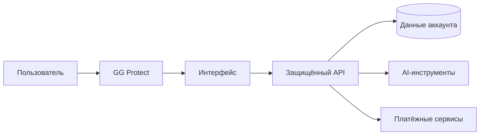

# Velocity: краткий доклад о проекте

[← Главная](https://github.com/SayGGGo/Velocity/blob/main/) · [Полная текстовая версия](README_TEXT.md)

**Velocity — образовательная платформа с AI-инструментами.** Она объединяет
личный аккаунт, работу с нейросетями и практику для школьников, студентов
и людей, осваивающих новые темы самостоятельно.

| Техническая информация | Значение |
| :--- | :--- |
| Тип проекта | A, B |
| Монетизация | B2C, B2B |
| Формат | Онлайн-платформа |
| Основной адрес | [isvelocity.ru](https://isvelocity.ru/) |

## Проблема и решение

Обучение часто разбито между материалами, отдельными AI-сервисами и практикой.
Velocity предлагает единый маршрут: выбрать задачу, открыть подходящий инструмент,
получить объяснение и перейти к самостоятельной работе.
Польза продукта проверяется обратной связью и реальными учебными сценариями;
гарантии оценок и результатов экзаменов не заявляются.

## Аудитория и сезонность

Подготовка к ЕГЭ и ОГЭ, сессии, начало учебного года, сдача проектов,
изучение сложной темы и самостоятельная практика. Платформа доступна онлайн;
эти сценарии описывают потребность, а не ограничивают работу конкретным сезоном.

## Устройство

Интерфейс построен на React и доставляется через GG Protect.
Серверный API проверяет права доступа, работает с PostgreSQL, AI и платежами.
Секреты и персональные данные не входят в публичную презентацию.

## Монетизация

**B2C:** тарифы AI-инструментов, пакеты токенов и использование баланса.
**B2B:** направление развития для организаций и образовательных команд;
оно не обозначает уже запущенные корпоративные продажи.
**VLTY SHOP:** фирменный мерч готовится к запуску, заказы пока закрыты.
Условия конкретной услуги подтверждаются в интерфейсе и оферте.

## Безопасность и открытые показатели

GG Protect фильтрует трафик на границе сети. Серверные проверки защищают
сессии, запросы и платежи. Служебный счётчик аккаунтов требует секретный ключ,
а его путь закрыт на внешнем веб-сервере. Он возвращает только общее число
аккаунтов и время обновления, без имён, почты и других пользовательских данных.

Публичные карточки показывают агрегаты GitHub, число аккаунтов из Velocity,
сумму HTTP-запросов и запросы, отмеченные GG Protect как угрозы, за 7 дней UTC.
Счётчики не выдаются за просмотры, уникальных посетителей или доказательство
вредоносности каждого отдельного запроса. Стрелы у щита — оформление,
а не визуализация отдельных атак в реальном времени.

## Обновление и ограничения

Сбор GitHub запускается после push в основную ветку и по расписанию раз в 5 минут.
Аккаунты и GG Protect обновляются раз в 2 минуты. GitHub может задерживать
расписание Actions и кэшировать изображения; время успешного обновления
помогает отличить устаревшие данные от отсутствия активности.
При ошибке источника сохраняется последнее успешное значение, а не подставляется ноль.

Календарь использует настоящие даты UTC за последний год. Клетки соответствуют
дням недели; с началом новой недели старые столбцы уходят за границу периода.

[Проблема](PROBLEM.md) · [Архитектура](ARCHITECTURE.md)
· [Бизнес-модель](../BUSINESS.md) · [Безопасность](../SECURITY.md) · [План](../TODO.md)

<a href="https://isvelocity.ru/"><picture><source media="(prefers-color-scheme: dark)" srcset="https://raw.githubusercontent.com/SayGGGo/VelocityReadmeAssets/main/learning-dark-3584d9d858bf.png"><source media="(prefers-color-scheme: light)" srcset="https://raw.githubusercontent.com/SayGGGo/VelocityReadmeAssets/main/learning-light-40e31de4bf1d.png"></picture></a>

